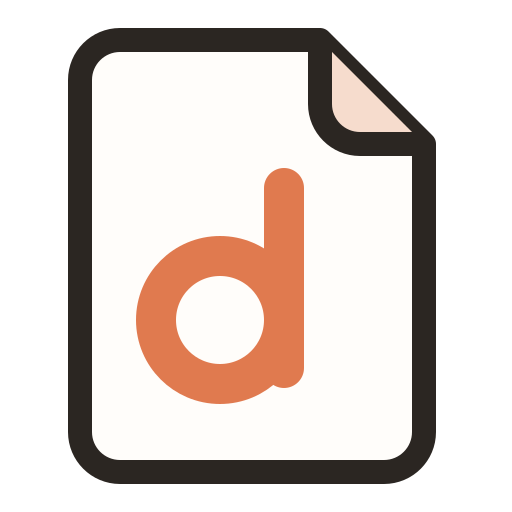
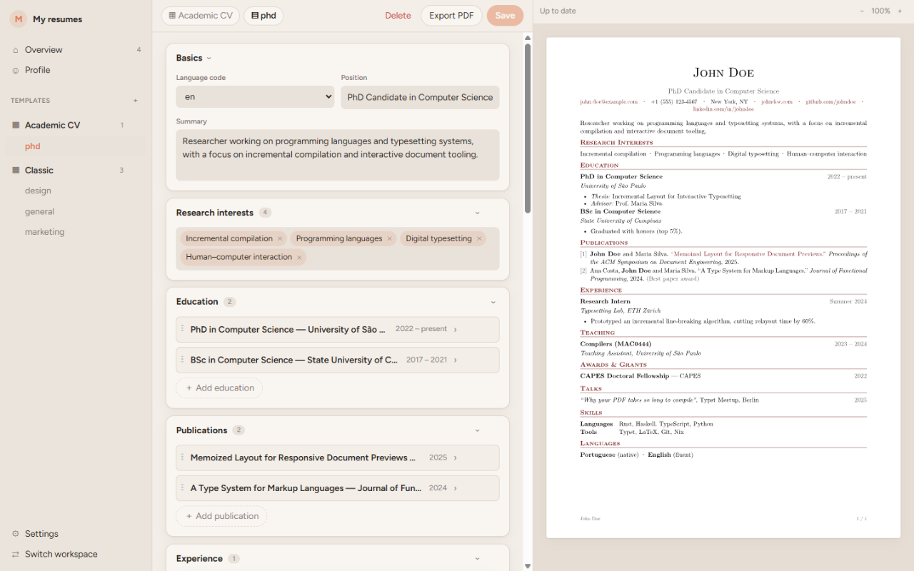
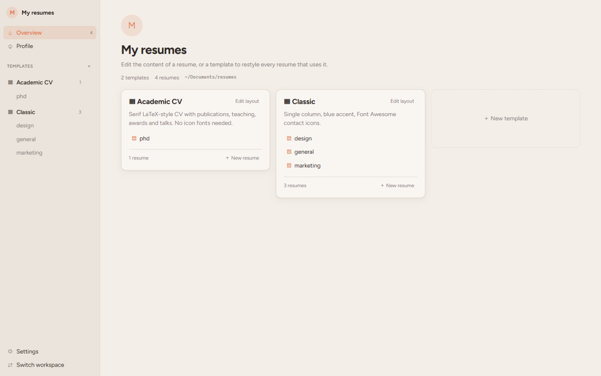
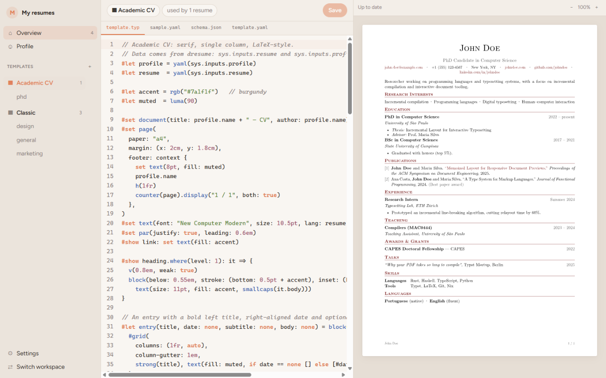
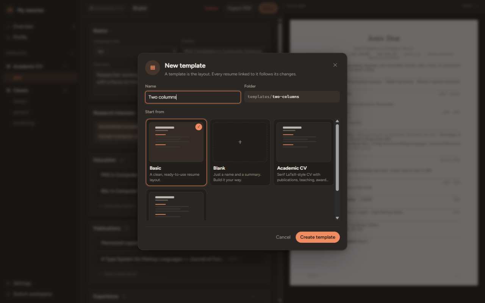
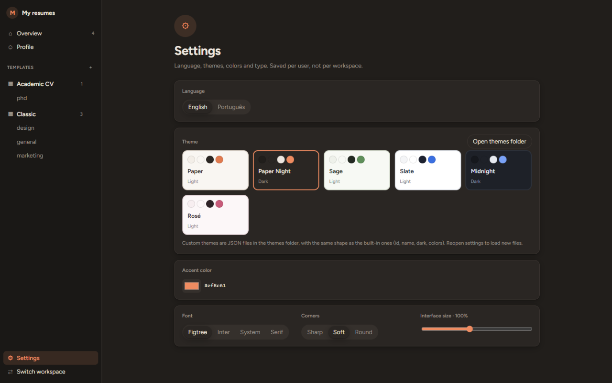
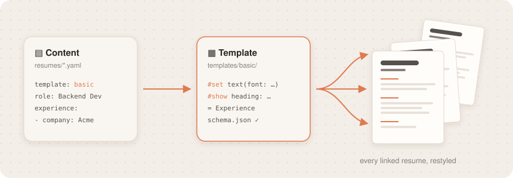
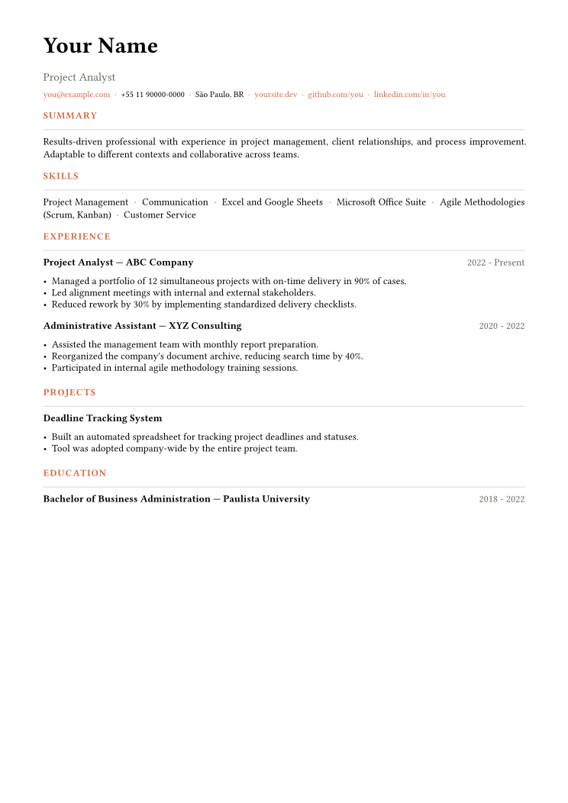
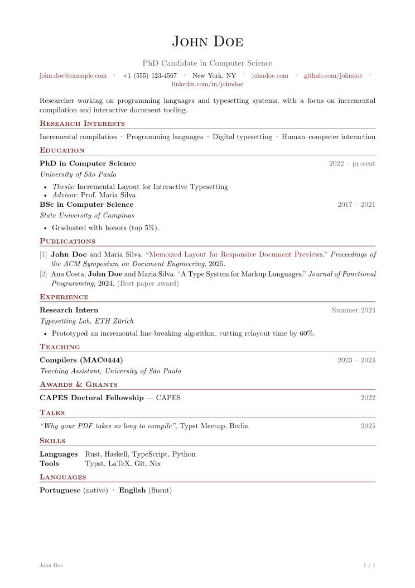

<div align="center">



# dresume

**Write your resume once. Restyle every version with one template.**

A desktop app and CLI for managing resumes, powered by [Typst](https://typst.app/).
Built so you *and* your AI agent can work on it.

[Features](#why-dresume) · [How it works](#how-it-works) · [Templates](#templates) · [Get started](#get-started) · [For AI agents](#for-ai-agents)

</div>

<br>

<p align="center"></p>

## Why dresume?

You probably have five versions of your resume: backend, frontend, English, Portuguese, "the one-page one".
Fixing a typo or changing the font means opening every file. dresume fixes that.

| | |
|---|---|
| 🎨 **One template, many resumes** | Change the layout once and every linked resume follows. |
| ✍️ **Edit content, not layout** | Friendly forms: sections, drag to reorder, bullets and tags. No code required. |
| 👀 **Live preview** | See the real result while you type. Export to PDF in one click. |
| 🧑‍💻 **Code when you want it** | Templates are plain Typst, with a built-in editor, highlighting and inline errors. |
| 🤖 **AI-friendly** | Plain files, a CLI with JSON output and a guide for agents. Ask an AI to tailor a resume or design a template. |
| 📁 **Your files, your folder** | No account and no cloud. It's a folder, so use git, Dropbox, anything. |
| 🌗 **Make it yours** | Themes (light & dark), accent color, fonts. English and Portuguese. |

## A quick tour

<table>
  <tr>
    <td width="50%"><br><b>Your workspace.</b> Templates and the resumes that use them, at a glance.</td>
    <td width="50%"><br><b>Template editor.</b> Typst with highlighting and a live preview.</td>
  </tr>
  <tr>
    <td><br><b>Start fast.</b> New templates from scratch, from Basic, or from a copy.</td>
    <td><br><b>Make it yours.</b> Six themes, any accent color, two languages.</td>
  </tr>
</table>

## How it works

<p align="center"></p>

```
my-resumes/
├── profile.yaml            ← your name, email and links, written once
├── templates/
│   └── basic/              ← the layout (Typst) + which fields it accepts
└── resumes/
    ├── backend-en.yaml     ← just content, linked to a template
    └── frontend-pt.yaml
```

That's it. **Content** goes in `resumes/`, **looks** go in `templates/`.

## Templates

Every new workspace comes with **Basic**, which works out of the box. Create your own from scratch, copy an
existing one, or ask an AI to make one for you.

<table>
  <tr>
    <td align="center"><br><b>Basic</b></td>
    <td align="center"><br><b>Academic CV</b></td>
  </tr>
</table>

## Get started

> Prebuilt installers are coming soon. For now, build from source.

**You need:** [Rust](https://rustup.rs/), [Node.js](https://nodejs.org/) and [pnpm](https://pnpm.io/).
Typst does **not** need to be installed: it's built in.

```bash
git clone https://github.com/diegorezm/dresume
cd dresume/app
pnpm install
pnpm tauri dev
```

Then click **New workspace**, pick a folder, and start editing `my-resume`.

### Prefer the terminal?

```bash
cargo install --path crates/cli

dresume init my-resumes
dresume -w my-resumes build          # → my-resumes/output/*.pdf
```

## For AI agents

Every workspace includes an `AGENTS.md` that teaches agents the format, and the CLI speaks JSON:

```bash
dresume list --json                    # templates and their resumes
dresume show backend-en                # a resume as JSON
dresume validate --json                # check content against the template
dresume build backend-en --format svg  # render pages so the agent can look at them
```

Try prompts like *"tailor my backend resume for this job post"* or *"make a two-column template with a dark sidebar"*.

## Contributing

Contributions are welcome. Start with [`AGENTS.md`](AGENTS.md): it maps the codebase and its conventions,
for humans and agents alike.

## License

[AGPL-3.0-or-later](LICENSE)
